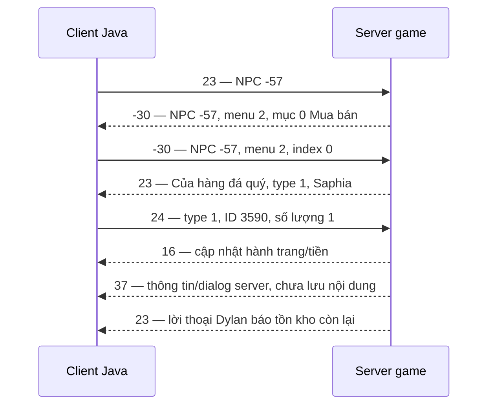

# Gói tin menu, shop và mua Saphia của Mr Dylan

Ngày ghi nhận: **13/10/2026**, giờ Việt Nam (UTC+7). Client: Java/MicroEmulator, Knight Online v403.

**Đã xác minh hai lượt gửi gói mua thành công tại Cửa Biển (map 19). Lượt đối chứng cùng tài khoản ở map 8 gửi lại menu 2 và gói mua nhưng chưa có xác nhận. Các gói gửi chỉ mang dữ liệu thao tác; map, vị trí, tài khoản và trạng thái thương nhân không nằm trong payload mua. Chưa thể từ đó kết luận server không kiểm tra các trạng thái này.**

## 1. Chuỗi giao tiếp đã thành công



Ba payload gửi thực tế:

| Thao tác | Opcode thập phân | Opcode hex | Payload hex | Độ dài payload |
| --- | --- | --- | --- | --- |
| Yêu cầu menu Dylan | 23 | `17` | `C7` | 1 byte |
| Chọn Mua bán | -30 | `E2` | `FF C7 02 00` | 4 byte |
| Mua một Saphia | 24 | `18` | `01 0E 06 00 01` | 5 byte |

Đây là payload trước đóng khung/mã hóa session, không phải bản sao toàn bộ byte trên socket.

## 2. Thành phần từng gói gửi

### 2.1. Opcode 23: yêu cầu menu NPC

```java
Message packet = new Message((byte)23);
packet.writer().writeByte(-57);
```

| Offset | Kiểu Java | Trường | Giá trị | Hex |
| --- | --- | --- | --- | --- |
| 0 | byte, 1 byte | NPC ID | -57, Mr Dylan | `C7` |

Gói này không chứa map, khu, tọa độ hay tên NPC. ID âm được ghi theo biểu diễn bù hai 8 bit: -57 tương ứng `0xC7`.

Hàm gốc: `GlobalService.getlist_from_npc(byte)`. Hàm tạo Message riêng dùng trong diagnostic: `remoteSellMenu(int)`.

### 2.2. Opcode -30: chọn mục trong menu

```java
packet.writer().writeShort(-57);
packet.writer().writeByte(2);
packet.writer().writeByte(0);
```

| Offset | Kiểu Java | Trường | Giá trị | Hex |
| --- | --- | --- | --- | --- |
| 0 | short, 2 byte | NPC ID | -57 | `FF C7` |
| 2 | byte, 1 byte | Menu ID | 2 | `02` |
| 3 | byte, 1 byte | Index lựa chọn | 0, Mua bán | `00` |

Menu ID và index là hai trường riêng. Index bắt đầu từ 0. Trong lượt thành công, server trả menu ID 2; không lấy số 2 từ vị trí lựa chọn.

Client gốc giữ ID/menu/index trong `Menu2`, rồi gọi `GlobalService.Dynamic_Menu(...)`. Diagnostic có thể dùng `remoteSellShop(...)` để tạo Message riêng nhưng payload vẫn cùng cấu trúc.

### 2.3. Opcode 24: mua vật phẩm

```java
packet.writer().writeByte(1);
packet.writer().writeShort(3590);
packet.writer().writeShort(1);
```

| Offset | Kiểu Java | Trường | Giá trị | Hex |
| --- | --- | --- | --- | --- |
| 0 | byte, 1 byte | typebuy | 1, loại shop item trong lượt này | `01` |
| 1 | short, 2 byte | idbuy | 3590, Saphia trong shop thật | `0E 06` |
| 3 | short, 2 byte | soluong | 1 | `00 01` |

`typebuy=1` không phải ID NPC, menu ID, category vật phẩm hay loại tiền. Saphia trong dữ liệu shop có category 3, nhưng trường gửi mua vẫn là typebuy 1.

Gói mua **không chứa** giá 10.000, tên Saphia, tài khoản, map, khu, tọa độ, NPC ID hoặc ID lạc đà. Những gì server biết về nhân vật/ngữ cảnh có thể đến từ phiên kết nối và các trạng thái đã lưu trước đó.

`GlobalService.buy_item(byte, short, short)` ghi đúng ba trường trên. Nút mua một món trong `TabShopNew` lấy `IDTab`, `item.Id`, số lượng 1 để gọi hàm này. Diagnostic gửi Message riêng với cùng payload.

## 3. Đóng khung trên socket

`DataOutputStream` ghi số nhiều byte theo **big-endian**. Các chuỗi trong phản hồi dùng `writeUTF/readUTF` của Java: độ dài 2 byte rồi dữ liệu modified UTF-8; không phải chuỗi kết thúc bằng byte 0.

Đối với các opcode thường ở đây, khung logic trước mã hóa là:

```text
byte opcode | unsigned short độ dài payload | payload
```

Ví dụ khung chưa mã hóa, dựng từ code:

```text
17 00 01 C7                   yêu cầu menu
E2 00 04 FF C7 02 00          chọn Mua bán
18 00 05 01 0E 06 00 01       mua 1 Saphia
```

Đây không phải capture socket thô. Sau bắt tay lấy khóa, `Session_ME.doSendMessage()` biến đổi opcode, hai byte độ dài và từng byte payload bằng khóa XOR với chỉ số `curW` tăng dần. Chiều nhận dùng `curR` riêng. Vì vậy không sao chép nguyên byte đã mã hóa của một phiên/lượt gửi sang phiên khác; các lượt thử dùng `Message` và session đang đăng nhập để xử lý đúng khung/khóa.

## 4. Server trả menu như thế nào?

Opcode nhận **-30** được `ReadMessenge.Dynamic_Menu(Message)` đọc:

```text
short npcId
byte  menuId
byte  số lựa chọn
UTF   nhãn lựa chọn 0
...   nhãn các lựa chọn tiếp theo
UTF   tiêu đề menu
```

Trong lượt thành công: NPC -57, menu 2, một lựa chọn `Mua bán` ở index 0. Log game ghi tiêu đề menu `MENU`.

Trong lượt khác map trước đó, server vẫn trả menu Mua bán nhưng menu ID là 0. Điều này cho thấy phải đọc ID từ phản hồi; không mặc định menu Dylan luôn bằng 0 hoặc luôn bằng 2. Menu root hiện được chưa chứng minh shop bên trong được server chấp nhận.

## 5. Phản hồi shop thật: opcode 23, type 1

Payload shop đã lưu dài **53 byte**, tiêu đề đúng byte/log là **`Của hàng đá quý`** (giữ nguyên cách viết server gửi), một item Saphia. Diagnostic lưu ở `E:\hso\patch_bin\dylan_replay\server-shop-payload.bin`.

Giải mã theo nhánh `SHOP_ITEM` của client:

| Offset | Trường | Kiểu/độ dài | Giá trị |
| --- | --- | --- | --- |
| 0 | Tiêu đề shop | UTF, 23 byte gồm độ dài | Của hàng đá quý |
| 23 | Loại shop | byte | 1 |
| 24 | Số món trong danh sách | short | 1 |
| 26 | ID món | short | 3590 |
| 28 | Tên món | UTF, 8 byte gồm độ dài | Saphia |
| 36 | `classcharItem` | byte | 4 |
| 37 | `type_Only_Item` | byte | 50 |
| 38 | Icon/image ID | short | 725 |
| 40 | Giá | long, 8 byte | 10.000 |
| 48 | `LvItem` | short | 1 |
| 50 | `colorNameItem` | byte | 0 |
| 51 | Số option chỉ số | byte | 0 |
| 52 | `priceType`/loại tiền | byte | 0, Vàng (`player.coin`) |

Nếu số option khác 0, sau trường đếm option có các cặp `unsigned byte optionId + int optionValue`, rồi mới đến loại tiền. Các offset ở bảng chỉ đúng payload một món Saphia đã capture, không cố định cho mọi shop.

Payload đầy đủ đã giải mã, trước khung/mã hóa:

```text
00 15 43 E1 BB A7 61 20 68 C3 A0 6E 67 20 C4 91 C3 A1 20 71 75 C3 BD
01 00 01 0E 06 00 06 53 61 70 68 69 61 04 32 02 D5
00 00 00 00 00 00 27 10 00 01 00 00 00
```

Các trường class/type/icon/color mô tả vật phẩm trên client. Chưa thử riêng để kết luận chúng là điều kiện server bắt buộc đối với người mua.

## 6. Server trả gì sau mua?

### Opcode 16: cập nhật hành trang và tiền

`charInventory()` chuyển vào `update_InVen_Or_Chest(..., act=0)`. Phần đầu parser của opcode 16:

```text
byte chế độ cập nhật
byte nhóm/category cập nhật
long player.coin     // Vàng hiển thị trong hai lượt này
int  player.gold     // loại tiền còn lại, khác coin
... phần item tùy chế độ/category
```

Diagnostic ghi số vàng **sau khi handler game xử lý phản hồi server**, không tự trừ tiền. Chưa lưu payload thô opcode 16 trong hai lượt, nên không ghi giá trị chế độ/category hoặc mô tả item mới như dữ liệu đã capture.

### Opcode 23, type/id -57: lời thoại tồn kho

Phần đầu vẫn là `UTF nội dung + byte type/id`. Với type -57, client coi là lời thoại NPC, không phải shop type 1.

Đã ghi nhận: `Ta chỉ còn 198 viên saphia mà thôi, nhanh tay lên kẻo hết.` và sau lượt tiếp theo là 197 viên. Thông tin này có thể đến chậm theo nhịp cập nhật NPC; không dùng riêng lời thoại tồn kho để xác nhận một giao dịch của chính mình.

### Opcode 37: thông tin/dialog server

Log game có opcode 37 ngay sau cập nhật mua. Handler đúng là `InfoServer_Download`, đọc `UTF nội dung + UTF chuỗi phụ + byte loại` để hiện dialog/thông tin. **Opcode 37 không phải gói cập nhật PK.** Hai lượt chưa lưu nội dung payload này, nên chưa xác định server đã thông báo câu gì.

Không có gói trả lời dialog -32 do diagnostic tự gửi trong hai lượt thành công.

## 7. Yêu cầu và điều kiện: biết gì, chưa biết gì?

| Mục | Đã biết | Giới hạn kết luận |
| --- | --- | --- |
| Phiên kết nối | Dùng session đăng nhập đang hoạt động, Message qua sender gốc | Gói mua không tự mang danh tính tài khoản |
| Menu | Lượt thành công lấy menu ID 2/index 0 từ server | Chưa chứng minh chỉ đổi 0 → 2 đủ mua khác map |
| Shop | Server trả type 1, ID 3590, giá 10.000, tiền type 0 | Chưa chứng minh bắt buộc phải mở shop trước mọi lần mua |
| Số lượng | Đã thử số lượng 1 | Chưa thử giới hạn số lượng/stack |
| Vàng | Server khấu trừ đúng 10.000 mỗi lượt | Chưa thử thiếu tiền hoặc thay đổi giá |
| Tồn kho | Lần lượt 199 → 198 → 197 theo lời thoại server | Chưa thử lúc hết hàng |
| Map/khu | Hai lượt thành công ở map 19 Cửa Biển, area 5 (khu hiển thị 6) | Gói không có map/khu nhưng server vẫn có thể kiểm tra trạng thái này |
| Vị trí | Dylan ở `(948,192)`; hai lượt tại `(996,234)` và `(978,198)` | Chưa đo ngưỡng khoảng cách tối đa server cho phép |
| Vai trò | Nhân vật lronic có `typePk=11` ở hai lượt | Đây là trạng thái quan sát và guard của diagnostic, chưa phải bằng chứng đầy đủ về điều kiện server |
| Trang bị/thú đi buôn/sức chứa | Chưa capture đủ trạng thái liên quan | Chưa xác định server kiểm tra trang bị, lạc đà gần hay sức chứa ra sao |

Source server đang chơi không có trong repo. Không lấy điều kiện của server HSO công khai khác làm điều kiện chắc chắn của server live.

Ngoài điều kiện giao thức, diagnostic có các guard riêng: đúng tài khoản/số dư ban đầu, không có lượt bán khác, giữ map/khu/vị trí trong lúc thử, tên chính xác Saphia và giá 10.000 từ shop thật, chỉ gửi một lần mua, không tự retry. Đây là các kiểm tra của công cụ thử, **không phải các trường gửi lên server hay bằng chứng server bắt buộc chúng**.

## 8. Bằng chứng hai lượt thành công

| Lượt, giờ Việt Nam | Tài khoản/map | Gói mua | Phản hồi tiền | Tồn kho NPC |
| --- | --- | --- | --- | --- |
| 22:38:03–22:38:09 | lronic, map 19 | `01 0E 06 00 01` | RX 16: 236.885 → 226.885 | 199 → 198 |
| 22:40:43–22:40:58 | lronic, map 19 | `01 0E 06 00 01` | RX 16: 226.885 → 216.885 | 198 → 197 |

Lượt 22:27 trên map 8 dùng tài khoản **phuctien**, nhận menu 0 rồi gửi `FF C7 00 00`, không nhận shop trong cửa sổ chờ. Vì cả tài khoản và map đều khác hai lượt thành công, không quy nguyên nhân chỉ cho map/menu ID. Cần thử đối chứng cùng tài khoản ở map khác.

### Lượt đối chứng cùng tài khoản ở map 8 — 22:53:58–22:54:14

Người dùng tự đưa **lronic** sang Thung Lũng Kỳ Bí, map 8/area 5, local `(150,846)`, vàng 216.885. Dylan không có trong danh sách NPC quét được trên map này. Hook chờ đúng thao tác chọn Mua bán của người dùng, không tự chọn menu hoặc tự di chuyển.

| Thời điểm | Sự kiện | Kết quả |
| --- | --- | --- |
| 22:53:57 | RX menu thật từ server | NPC -57, menu 0, Mua bán |
| 22:53:58 | Người dùng chọn index 0 | Thay đúng một gói lựa chọn bằng `FF C7 02 00`, opcode -30 |
| 22:54:04 | Chờ shop 6,5 giây | Không nhận shop thật của Dylan |
| 22:54:04 | Thử một gói mua đã xác minh | Opcode 24, `01 0E 06 00 01`; không retry |
| 22:54:14 | Kết thúc cửa sổ kiểm tra 10 giây sau mua | Không có opcode 16 xác nhận; vàng 216.885 → 216.885 |

Không có shop cục bộ/cache được dựng để giả phản hồi. Không ghi nhận dialog/thông báo nêu lý do. Hook sender/receiver đã được trả về delegate gốc; số lần gửi mua là 1.

Kết luận riêng cho nhánh này: **cùng tài khoản, đổi menu ID sang 2 rồi gửi đúng gói mua vẫn chưa mua được ở map 8**. Không coi tiền không đổi là lời từ chối tường minh của server và không suy ra chính xác điều kiện bị thiếu. Map, khoảng cách đến NPC, trạng thái thú đi buôn/ngữ cảnh shop là các yếu tố vẫn cần xác minh; không kết luận chỉ gọi menu local hoặc đổi menu ID sẽ đủ.

Các diagnostic chỉ gửi menu/lựa chọn/mua theo yêu cầu, không đổi map, không gửi tọa độ ảo, không tái phát shop local hay hành trang giả. Người dùng tự di chuyển/đổi tài khoản giữa các lượt.

## 9. Nguồn để đối chiếu và tái hiện

- [GlobalService.java](E:/hso/src_java/netcommand/global/GlobalService.java:236): các gói yêu cầu menu, chọn menu, mua.
- [Menu2.java](E:/hso/src_java/Model/Menu2.java:731): thao tác menu thành Dynamic_Menu.
- [TabShopNew.java](E:/hso/src_java/InterfaceComponents/TabShopNew.java:466): gửi mua một món bằng IDTab/item ID/số lượng.
- [ReadMessenge.java — shop](E:/hso/src_java/netcommand/global/ReadMessenge.java:1620): parse opcode 23, shop type 1 và lời thoại NPC.
- [ReadMessenge.java — menu](E:/hso/src_java/netcommand/global/ReadMessenge.java:2615): parse menu server, giữ menu ID.
- [ReadMessenge.java — hành trang/tiền](E:/hso/src_java/netcommand/global/ReadMessenge.java:4593): header opcode 16 và cập nhật coin/gold.
- [Session_ME.java](E:/hso/src_java/CLib/Session_ME.java:70): đóng khung, khóa và sender.
- [HsoDylanPurchaseReplay.java](E:/hso/tools/diagnostics/HsoDylanPurchaseReplay.java): hai lượt mua có guard và một lần gửi.
- [HsoDylanRemoteClickReplay.java](E:/hso/tools/diagnostics/HsoDylanRemoteClickReplay.java): lượt đối chứng cùng tài khoản ở map 8, kích hoạt bằng lần người dùng chọn Mua bán.
- [TAI_LIEU_KIEM_THU_BAN_TU_XA.md](E:/hso/TAI_LIEU_KIEM_THU_BAN_TU_XA.md): lịch sử các hướng thử và giới hạn kết luận.

Log live: `E:\hso\hso_remote_sell_probe.log` (tiền tố `DYLAN_PROBE`, `DYLAN_REPLAY`, `DYLAN_REMOTE_CLICK`) và `E:\hso\hso_debug.log`. Log và payload thô nằm trong các đường dẫn bỏ qua bởi Git; tài liệu này lưu các giá trị đã đối chiếu để đọc lại.
